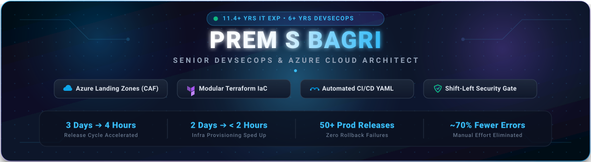
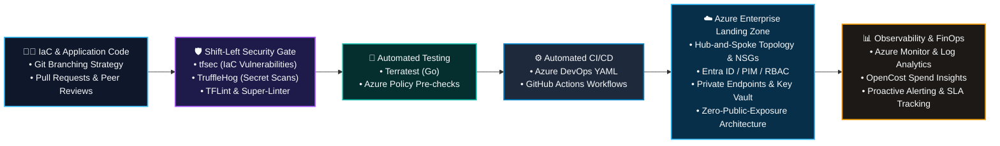

<div align="center">

  <!-- Hero Header Banner -->
  

  <br/><br/>

  <!-- Dynamic Animated Typing Subtitle -->
  <a href="https://linkedin.com/in/premsbagri">
    
  </a>

  <br/>

  <!-- Quick Badges Strip -->
  <p align="center">
    <a href="https://www.linkedin.com/in/premsbagri" target="_blank">
      
    </a>
    <a href="mailto:prem.bagri91@gmail.com">
      
    </a>
    
    
    
  </p>

</div>

---

### 👨‍💻 Executive Summary

I am a **DevSecOps and Cloud Platform Engineer** with **11.4 years of IT experience**, including **6+ years of dedicated, hands-on expertise in Microsoft Azure, Infrastructure as Code (Terraform), and secure CI/CD pipeline implementation**.

I specialize in architecting and governing enterprise-grade cloud environments using the **Microsoft Cloud Adoption Framework (CAF)**, automating **Hub-and-Spoke network topologies**, enforcing **Zero-Public-Exposure / Zero-Trust security** with Private Endpoints and Managed Identities, and integrating **Shift-Left security scans** directly into automated build/release workflows.

---

### ⚡ Engineering Impact & Milestones

<div align="center">

| Metric | Transformation Milestone | Enterprise Impact |
|:---:|:---|:---|
| ⏱️ **3 Days ➔ 4 Hours** | **Release Cycle Velocity** | Engineered automated Azure Pipelines & GitHub Actions, cutting release cycles by **>80%** |
| ⚡ **2 Days ➔ < 2 Hours** | **Environment Spin-up** | Developed modular, DRY Terraform templates adopted across **3 cross-functional project teams** |
| 🛡️ **50+ Releases / 0 Rollbacks** | **Production Stability** | Supported **50+ production deployments with zero rollback failures** and **~70% fewer manual errors** |
| 📉 **30% ➔ < 8%** | **Pipeline Reliability** | Redesigned CI/CD workflows and automated pre-flight linting, slashing build failures in **3 months** |
| 💰 **FinOps Optimization** | **Cloud Cost Governance** | Deployed **OpenCost** across Azure subscriptions to eliminate idle/oversized compute and storage |
| 👥 **Team Mentorship** | **DevSecOps Enablement** | Mentored **5 engineers** on Terraform, Terratest & security scanning, reducing support tickets by **60%** |

</div>

---

### 🛡️ End-to-End DevSecOps & Cloud Architecture



---

### 🛠️ Technical Competencies & Toolchain

<table>
  <tr>
    <td width="25%"><b>☁️ Cloud & Governance</b></td>
    <td>
      
      
      
      
      
      
      
    </td>
  </tr>
  <tr>
    <td width="25%"><b>⚡ Infrastructure as Code</b></td>
    <td>
      
      
      
      
      
      
    </td>
  </tr>
  <tr>
    <td width="25%"><b>🌐 Cloud Networking</b></td>
    <td>
      
      
      
      
      
      
      
      
      
    </td>
  </tr>
  <tr>
    <td width="25%"><b>🔄 CI/CD & Automation</b></td>
    <td>
      
      
      
      
      
      
    </td>
  </tr>
  <tr>
    <td width="25%"><b>🔒 DevSecOps & Security</b></td>
    <td>
      
      
      
      
      
      
    </td>
  </tr>
  <tr>
    <td width="25%"><b>🐳 Containers & PaaS Data</b></td>
    <td>
      
      
      
      
      
    </td>
  </tr>
  <tr>
    <td width="25%"><b>📊 Observability & FinOps</b></td>
    <td>
      
      
      
      
    </td>
  </tr>
  <tr>
    <td width="25%"><b>🛡️ BCDR & High Availability</b></td>
    <td>
      
      
      
      
      
    </td>
  </tr>
  <tr>
    <td width="25%"><b>💻 Scripting & Systems</b></td>
    <td>
      
      
      
      
    </td>
  </tr>
</table>

---

### 📂 Featured Cloud Repositories

<div align="center">

| Repository | Focus & Architecture | Technologies |
|:---|:---|:---:|
| 🚀 **[azure-landing-zone](https://github.com/premsbagri/azure-landing-zone)** | **Enterprise-grade Azure Landing Zone** following Microsoft CAF principles, automating Management Groups, RBAC, Subscriptions, Hub-and-Spoke connectivity, and Azure Policies. | `Terraform` `Azure CAF` `Azure Policy` `Networking` |
| ⚡ **[azure-infrastructure-platform](https://github.com/premsbagri/azure-infrastructure-platform)** | **End-to-End Azure Infrastructure Provisioning & Automation** utilizing modular IaC design, zero-trust network isolation, and automated Azure DevOps CI/CD pipeline triggers. | `Terraform` `Azure DevOps` `CI/CD` `YAML` |
| 🛡️ **[Azure_resource_deployment](https://github.com/premsbagri/Azure_resource_deployment)** | **Secure Core Compute & Networking Baseline** deploying Resource Groups, VNets, Subnets, Public IPs, Network Interfaces, and hardened Virtual Machines. | `HCL` `Azure VNet` `VM Provisioning` `IaC` |

</div>

---

### 💼 Professional Journey

```
┌────────────────────────────────────────────────────────────────────────────────────────┐
│  💼 Quess Corp Limited, Bangalore                                                      │
│  Senior DevSecOps & Cloud Platform Engineer                        (Oct 2023 – Present)│
├────────────────────────────────────────────────────────────────────────────────────────┤
│  • Designed & implemented enterprise Azure Landing Zones aligned with Microsoft CAF.   │
│  • Automated multi-environment infrastructure with modular Terraform & Terratest.     │
│  • Slashed average deployment cycle from 3 days to 4 hours via Azure DevOps pipelines. │
│  • Built shift-left DevSecOps gates using tfsec, TruffleHog, TFLint & Super-Linter.   │
│  • Implemented OpenCost for cross-subscription resource & cost visibility.             │
│  • Mentored 5 cloud engineers on IaC automation, cutting pipeline support tickets 60%.│
└────────────────────────────────────────────────────────────────────────────────────────┘
                                            │
                                            ▼
┌────────────────────────────────────────────────────────────────────────────────────────┐
│  💼 Quess Corp Limited, Bangalore                                                      │
│  Cloud & Infrastructure Automation Engineer                        (Apr 2021 – Sep 2023)│
├────────────────────────────────────────────────────────────────────────────────────────┤
│  • Managed Azure cloud infrastructure: VNets, NSGs, Resource Groups, and Compute.      │
│  • Maintained 20+ Terraform configs, reducing manual provisioning effort by ~50%.     │
│  • Supported 50+ production deployments with zero rollback failures.                  │
│  • Redesigned build workflows with dev/QA teams, cutting failure rate 30% to < 8%.     │
└────────────────────────────────────────────────────────────────────────────────────────┘
                                            │
                                            ▼
┌────────────────────────────────────────────────────────────────────────────────────────┐
│  💼 Quess Corp Limited, Bangalore                                                      │
│  Cloud Operations & Infrastructure Specialist                      (Apr 2018 – Mar 2021)│
├────────────────────────────────────────────────────────────────────────────────────────┤
│  • Monitored production VMs, Storage Accounts, and VNets via Azure Monitor dashboards.│
│  • Handled incident management, troubleshooting, and continuous service availability. │
│  • Validated deployments and generated audit reports for enterprise compliance.       │
└────────────────────────────────────────────────────────────────────────────────────────┘
                                            │
                                            ▼
┌────────────────────────────────────────────────────────────────────────────────────────┐
│  💼 Quess Corp Limited, Patna                                                          │
│  Operations Support & Systems Specialist                           (Jan 2015 – Mar 2018)│
├────────────────────────────────────────────────────────────────────────────────────────┤
│  • Delivered operational support, system monitoring, issue tracking, and workflow     │
│    coordination across enterprise systems.                                             │
└────────────────────────────────────────────────────────────────────────────────────────┘
```

#### 🎓 Education
- **Bachelor of Engineering (B.E.) in Computer Science** — Rajiv Gandhi Proudyogiki Vishwavidyalaya (RGPV University) *(2008 – 2012)*

---

### 📈 GitHub Analytics & Repository Activity

<div align="center">
  
  &nbsp;
  
</div>

<br/>

<div align="center">
  
</div>

---

### 🤝 Let's Connect & Collaborate!

I am always keen to connect with fellow Cloud Architects, DevSecOps practitioners, and engineering leaders discussing **Infrastructure as Code, Cloud Transformation, Enterprise Security, and FinOps**.

<div align="center">

  [](https://www.linkedin.com/in/premsbagri)
  &nbsp;
  [](mailto:prem.bagri91@gmail.com)
  &nbsp;
  [](https://github.com/premsbagri)

  <br/><br/>
  <sub>⭐ If you find my repositories or Terraform modules helpful, don't hesitate to star the repositories!</sub>

</div>
